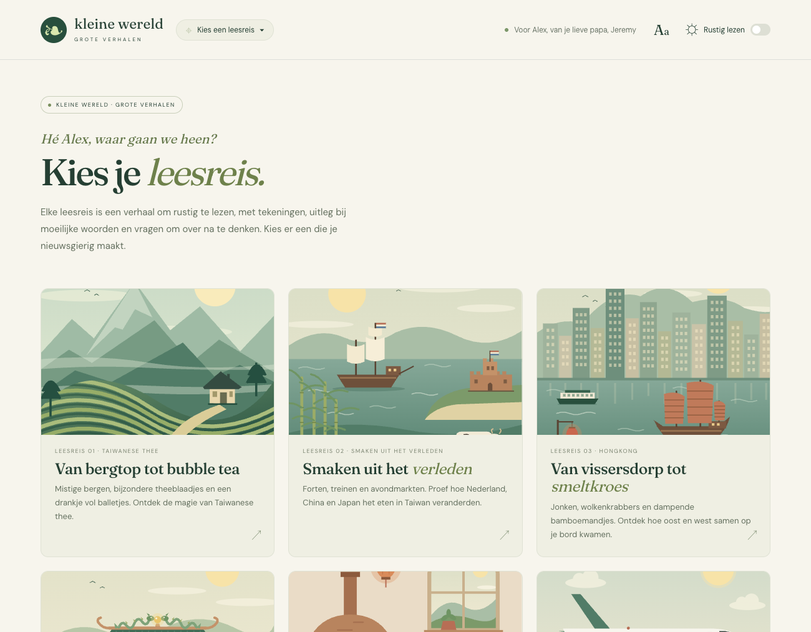

# alex-leesreizen

Calm, illustrated Dutch reading journeys (*leesreizen*) for practising reading comprehension (*begrijpend lezen*). It's a small, personal web app I made for my son Alex, so every journey is written for him and the copy speaks to him directly.



## What it does

Each journey takes one Dutch text of 3–6 paragraphs and turns it into a short trip:

- **Illustrated chapters**, one per paragraph, each with its own flat SVG drawing. Each journey opens with a gently animated scene.
- **Word help:** harder words are highlighted, and tapping one shows a child-friendly explanation.
- **Seven multiple-choice questions**, each with an explanation of the right answer and a score at the end.
- **Two or three open questions** answered in your own words, then compared with an example answer. They aren't graded automatically, so you can talk them over together.
- **A personal closing message** and the option to start the journey again.

There's no timer, no streaks and no pressure. Any chapter or question can be opened at any time.


### Journeys so far

| # | Title | Topic |
|---|---|---|
| 01 | Van bergtop tot bubble tea | Taiwanese tea, from mountain oolong to bubble tea |
| 02 | Smaken uit het verleden | How colonial history shaped Taiwanese food |
| 03 | Van vissersdorp tot smeltkroes | How Hong Kong grew, and east meets west in its food |
| 04 | Kleurrijke tempels | The gods and goddesses of Taiwan's temples |
| 05 | Bizarre pizza's | The strangest pizza flavours of Asia |
| 06 | Vliegen in de toekomst | Flying the Airbus A350 to Hong Kong |
| 07 | Achter de schermen | How alex-reads.ink works, from the name to the server |
| 08 | De stad zonder regels | Kowloon Walled City and cyberpunk; the preferred version |
| 09 | Van Doom tot Roblox: De Evolutie van de Shooter | How shooters evolved through Doom, Quake, Half-Life and Roblox Rivals |
| 10 | De Magische Wereld van Japanse Manga | Japanese comics and the influence of Tezuka, Toriyama and Oda |
| 11 | Slavernij, Keti Koti en de excuses van de koning | Dutch slavery, its abolition in 1863 and 1873, and the king's apology in 2023 |
| 12 | De grenzeloze groei van de mangawereld | How manga grew worldwide: the anime boost, Webtoons and manfra |

The original Grok Kowloon journey is archived: it stays available at `#/kowloon`, including its chapters, quiz and saved answers, but is hidden from the landing page and header switcher. The preferred version keeps its existing `#/kowloon-opus5-5-xhigh` URL. Display numbers can change; URL slugs and saved-answer keys stay unchanged.

### Comfortable reading

- **Rustig lezen** (quiet mode) hides the illustrations, stops the animations and gives the text more room.
- A button to enlarge the text.
- Full keyboard support, visible focus, layouts down to 360px wide, and respect for `prefers-reduced-motion`.

## Running it

You need Node.js 18 or newer (`node --version`). There's nothing to install:

```sh
git clone https://github.com/jphartley/alex-leesreizen.git
cd alex-leesreizen
npm start
```

Then open <http://localhost:3000>. Press Ctrl+C to stop the server. It only listens on your own computer (`127.0.0.1`). Set `PORT` to use a different port, e.g. `PORT=4000 npm start`.

To keep your terminal free, start it in the background instead. It prints the link, and adding a journey slug opens that journey directly:

```sh
npm run serve             # http://localhost:3000/
npm run serve -- kowloon-opus5-5-xhigh  # http://localhost:3000/#/kowloon-opus5-5-xhigh
lsof -ti tcp:3000 | xargs kill   # stop the background server
```

Open the app through the server, not as a file, because it fetches each journey's text.

Answers you give on `localhost` are saved separately from answers on <https://alex-reads.ink>, because each address has its own `localStorage`. Testing locally never touches answers saved on the live site.

Publishing to <https://alex-reads.ink> is described in [docs/railway.md](docs/railway.md). Answers still stay in the browser.

## Privacy

There are no accounts, no analytics and no backend. Answers and settings are saved only in the browser's `localStorage`. Only the fonts load from Google Fonts, and without internet the page falls back to local fonts.

## How it's built

Plain HTML, CSS and browser JavaScript modules: no framework, no build step, no dependencies. [GSAP](https://gsap.com) drives the hero animations and is vendored in `vendor/`.

```
index.html, app.js, styles.css   page shell, views and router, styles
store.js                         saved answers and settings (localStorage)
motion.js                        shared animation runtime
server.mjs                       small local static server
journeys/index.js                all routable journeys and the visible menu list
journeys/<slug>/
  text.md                        the Dutch text: a title and paragraphs
  journey.js                     chapters, glossary, questions, all copy
  art.js                         SVG illustrations
  motion.js                      the hero animation
scripts/                         checks and screenshot tools
```

### Checks

```sh
npm run check            # validates every journey's data and the storage migration
npm run check:browser    # end-to-end run of every journey in headless Chrome
npm run screenshot -- '#/taiwan' --text   # screenshot, plus a text tone map
```

The browser checks use the Chrome on your machine with a throwaway profile, so they never touch real saved answers.

## Adding journeys with AI coding tools

The app began with [Claude Code](https://claude.com/claude-code). Its `new-journey` workflow is now shared with Claude Code, Cursor and OpenAI Codex. Supply a Dutch text (a title and 3–6 paragraphs) and two or three open questions. The agent writes the chapters, glossary, multiple-choice questions and explanations, example answers, illustrations and animation, then registers the journey and checks it in a browser.

There is one source of truth: [.agents/skills/new-journey/SKILL.md](.agents/skills/new-journey/SKILL.md). Edit that file to update the workflow for every tool.

Use `/new-journey` in a chat attached to this repository. Include the Dutch text and two or three open questions, or send the command first and the agent will ask for them. `AGENTS.md` explicitly routes that message to the shared workflow, even when a client has not listed the skill.

| Client | Repository entry point | Command behavior |
|---|---|---|
| Claude Code | `.claude/skills/new-journey/SKILL.md` | Native `/new-journey` skill; loads the shared workflow |
| Cursor | `.cursor/commands/new-journey.md` and `.agents/skills/new-journey/SKILL.md` | Native `/new-journey` command/skill; loads the shared workflow |
| ChatGPT / Codex desktop app | `.agents/skills/new-journey/SKILL.md` and `agents/openai.yaml` | Enabled skills appear in the slash-command menu when the app discovers this repository skill |
| Codex CLI / IDE | `.agents/skills/new-journey/SKILL.md` | Native skill invocation is `$new-journey` or `/skills`; support for direct `/new-journey` depends on the client |
| ChatGPT web / cloud coding chat | `AGENTS.md` and the shared workflow in the attached checkout | Submit `/new-journey` as a message for the agent to follow; repository files do not register a custom web composer command |

A chat started from GitHub needs the latest `main` containing these files; local uncommitted changes are unavailable to a separate checkout. Pull the latest `main` for local tools, or start a new cloud coding chat on this repository after the change is pushed. Reload the client if its skill list is cached.

`/new-journey` must reach an agent with access to this repository and its `AGENTS.md`. A client that rejects unknown slash commands before sending them cannot be given a new native slash command by project instructions; use that client’s supported skill picker. Project files cannot change the command menus in unrelated chats or install account-wide skills.

The Claude and Cursor entry points are ordinary Markdown files, so they survive checkouts without symlink support. The workflow remains in the shared file. `CLAUDE.md` imports `AGENTS.md` so Claude receives the same project instructions. New journey numbers follow the active menu sequence; archived journeys retain their URLs and saved answers.

Discovery and client differences follow the official [Codex skill documentation](https://developers.openai.com/codex/skills), [desktop slash-command documentation](https://learn.chatgpt.com/docs/reference/slash-commands), [Codex developer commands](https://learn.chatgpt.com/docs/developer-commands), [Cursor skill documentation](https://cursor.com/docs/skills), and [Claude Code skill documentation](https://code.claude.com/docs/en/skills).

The texts themselves come from me. The quiz answers are checked by a human, because the automated checks can't tell whether an answer is factually right.

## Licence

[MIT](LICENSE). GSAP in `vendor/` is distributed under its own [licence](https://gsap.com/standard-license).
